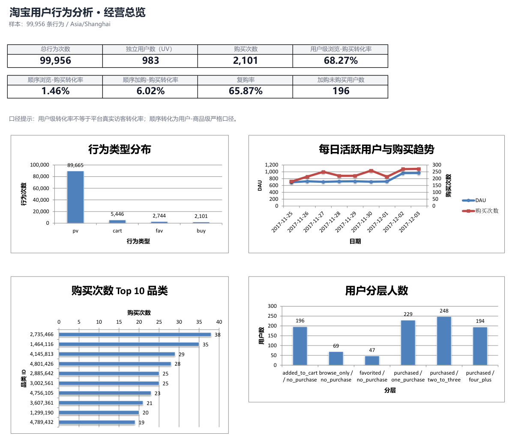
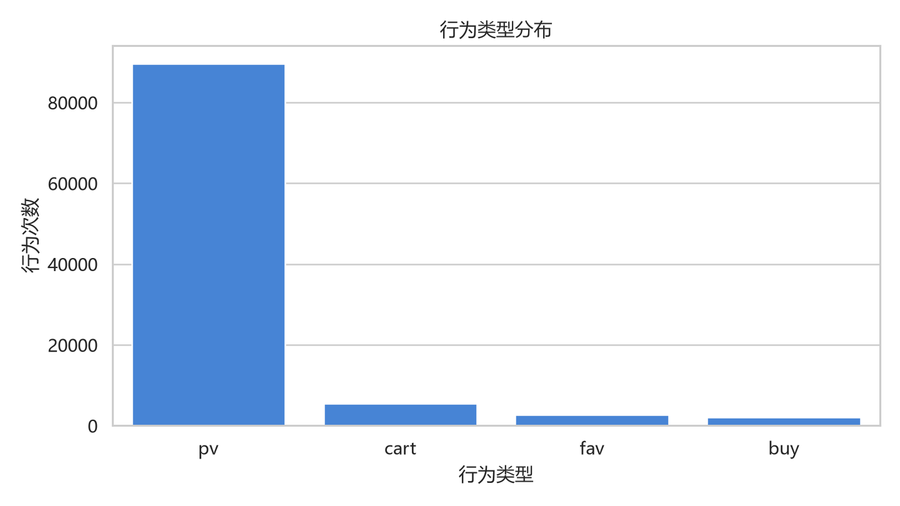
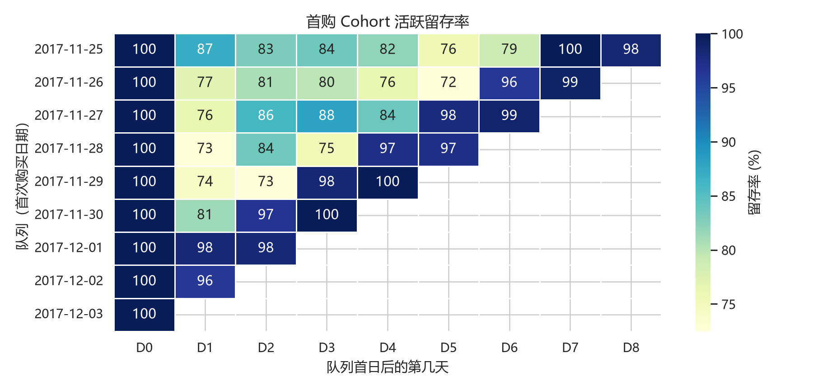
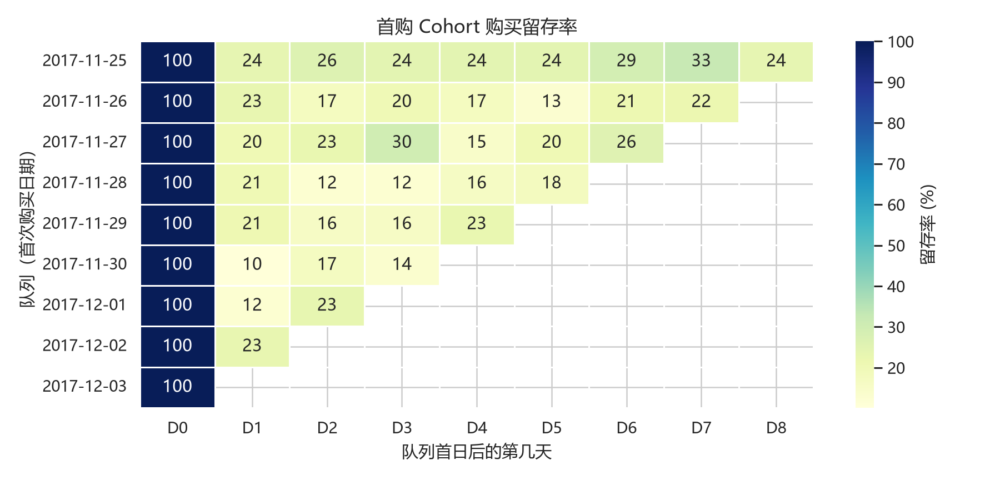
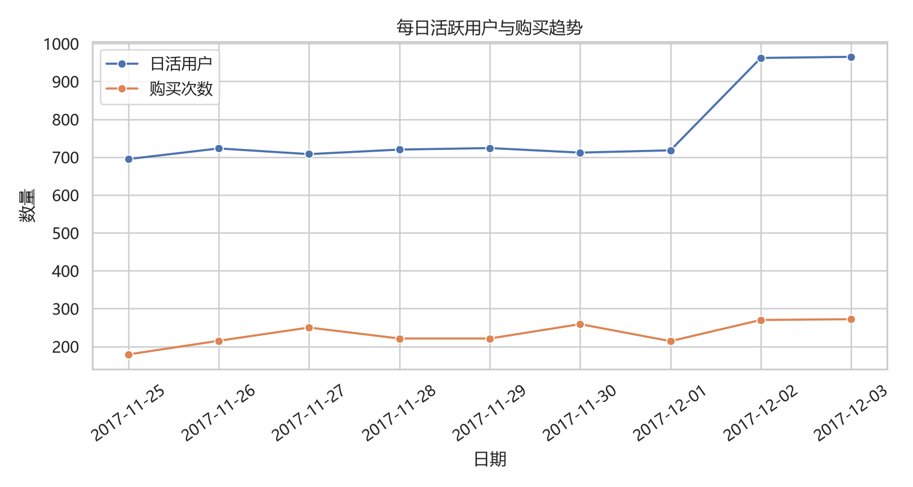
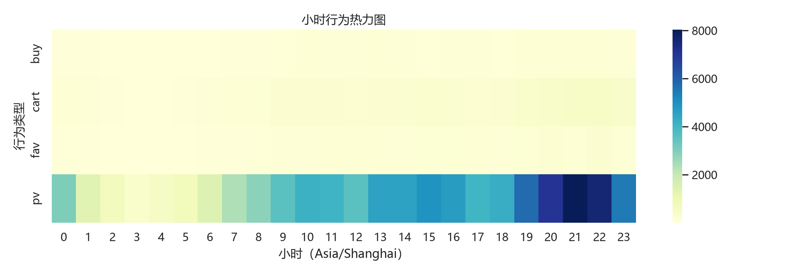

# 淘宝用户行为与转化漏斗分析

Taobao User Behavior & Conversion Funnel Analysis

> 基于淘宝 UserBehavior 公开数据集的 10 万行真实样本，完成数据清洗与抽样偏差对照，构建用户级 / 用户-商品级双口径转化漏斗与首购 Cohort 留存，并用一条命令自动生成 Excel 看板。



*上图由 `python src/generate_reports.py` 生成：8 个 KPI、4 张图、7 个工作表。删除 `dashboard/auto_dashboard.xlsx` 后重跑命令即可重建。*

## 核心结论

**1. 行为结构稳定，但“高转化率”是观察口径造成的。**
样本中浏览（PV）占 89.70%、购买占 2.10%，两种抽样方式下几乎一致。用户级浏览-购买转化率为 **68.27%**，换成“同一用户-同一商品且先浏览后购买”的严格口径后只剩 **1.46%**，相差约 47 倍。前者适合看人群购买覆盖，后者才接近具体商品路径转化。

**2. 抽样方式会直接改写结论。**
同一份全量数据，顺序抽样下 UV 为 983、复购率 65.87%、顺序漏斗 1.46%；随机按行抽样下 UV 为 91,923、复购率 0.30%、顺序漏斗归零。差的是“用户行为是否被完整保留”，不是业务能力。→ [reports/sampling_comparison.md](reports/sampling_comparison.md)

**3. 留存只能看短期，而且要识别大盘干扰。**
671 名首购用户形成 9 个队列，D1 活跃留存 82.0%、购买留存 20.1%。D7 活跃留存 99.6% 是 12-02/12-03 全站 DAU 高峰（962/965，平时约 710）抬起来的，不能当成留存变好。→ [reports/cohort_retention.md](reports/cohort_retention.md)

**4. 最明确的运营落点是“加购未购买”人群。**
样本中有 **196** 人加购后未购买；用户级加购-购买转化率为 72.89%，说明加购人群意向更强。购买次数 Top 品类为 `2735466`（38 次），购买高峰在 **13:00**（Asia/Shanghai）。

**5. 产物可一键复现。**
一条 `python src/generate_reports.py` 同时重算主分析指标、生成 Markdown 报告与图表、以及 7 页 Excel 看板（Cohort 报告由 `cohort_retention.py` 单独生成）；`python -m pytest` 的 5 个用例覆盖数据清洗与核心指标。

## 怎么跑

```powershell
pip install -r requirements.txt
python src/generate_reports.py
python src/cohort_retention.py --compare-input data/cleaned_user_behavior_random_sample.csv --compare-label "随机按行抽样"
python -m pytest
```

仓库已包含 10 万行样本和对照样本，**不需要先下载原始数据**即可跑通。从全量数据重新抽样的命令见 [How to Run](#how-to-run)。

## 指标口径说明

### 两套漏斗

| 口径 | 定义 | 适用场景 | 样本结果 |
| --- | --- | --- | ---: |
| 用户级转化 | 同一用户在窗口内是否同时出现过浏览和购买 | 看人群购买覆盖 | 68.27% |
| 用户-商品级顺序转化 | 同一 `user_id + item_id` 先浏览/加购，之后才购买 | 看具体商品路径转化 | 1.46% / 6.02% |

两个指标回答的不是同一个问题。只看 68.27% 会误判平台转化能力，只看 1.46% 又会漏掉人群整体购买覆盖，所以必须同时展示。

### 首购 Cohort

- 队列：按用户首次购买日期分组，共 9 个队列（2017-11-25 至 2017-12-03）。
- 第 N 天 = 行为日期 − 队列日期；D0 为队列当天，活跃留存和购买留存都应为 100%。
- 活跃留存 = 当天有任意行为；购买留存 = 当天再次购买。
- 尚未到观察期的格子记为“—”，**不能当成 0**；否则尾部会被误读成流失。

### 抽样方式

- **主分析使用顺序抽样**：连续读取全量文件前 10 万行，保留同一用户的完整行为路径，但只覆盖 983 个重度用户。
- **对照样本使用随机按行抽样**：固定随机种子 42，保留为 `data/cleaned_user_behavior_random_sample.csv`，仅用于 `sampling_comparison.md` 和 Cohort 报告第 10 节。
- 两种方式对 UV、复购率、顺序漏斗的影响已量化；完整对比与复现命令见 [reports/sampling_comparison.md](reports/sampling_comparison.md)。

### 金额字段

原始数据没有金额字段，因此本项目**不计算 GMV、客单价，也没有做 RFM 的 M 维度**。用户价值只按购买次数、活跃天数和行为深度分层，避免用替代指标冒充金额口径。

## 已知局限

- **没有曝光分母**：样本只包含已产生行为的用户记录，不含曝光人群、站外访客和新访客，因此用户级转化率不能等同于平台真实访客转化率。
- **主样本有偏**：顺序抽样只覆盖 983 个重度用户，人均 101.68 条行为，复购率、留存率和用户级转化率都会偏高。
- **窗口只有 9 天**：只能看短期回访，不能外推月留存或长期留存。
- **没有金额字段**：无法计算 GMV、客单价，用户价值只能用购买广度近似。
- **没有对照组和显著性检验**：业务建议是基于样本的假设，不是因果结论；落地前需要 A/B 测试验证。

## 技术栈

- Python / Pandas / NumPy：数据清洗、指标计算
- Matplotlib / Seaborn：趋势图、热力图
- SQL：16 条分析查询（`sql/taobao_behavior_analysis.sql`）
- xlsxwriter：脚本自动生成 Excel 看板
- pytest：数据清洗与指标测试
- Jupyter Notebook：探索性分析
- Dify Knowledge / RAG：可选扩展文档（原项目自带，当前版本未改动）

## 目录结构

```text
Taobao-User-Behavior-Conversion-Analysis/
|-- README.md                         门面：结论、口径、运行方式
|-- requirements.txt
|-- data/
|   |-- README.md                     数据来源 + 抽样说明
|   |-- raw_user_behavior_sample.csv          主样本（顺序抽样）
|   |-- cleaned_user_behavior.csv             主样本清洗后（99,956 行 / 983 用户）
|   |-- raw_user_behavior_random_sample.csv   对照样本（随机种子 42）
|   `-- cleaned_user_behavior_random_sample.csv
|-- src/
|   |-- prepare_real_data_sample.py   ① 从全量数据抽 10 万行
|   |-- data_cleaning.py              ② 清洗 + 时区转换
|   |-- analysis.py                   ③ 核心指标与漏斗
|   |-- cohort_retention.py           ④ 首购 Cohort 留存
|   |-- generate_reports.py           ⑤ 报告 + 图 + 看板（主入口）
|   `-- export_dashboard.py           ⑥ 由 dashboard_data.json 生成 xlsx
|-- sql/
|   |-- README.md
|   `-- taobao_behavior_analysis.sql  16 条 PostgreSQL 查询
|-- reports/
|   |-- analysis_summary.md
|   |-- business_insights.md
|   |-- data_quality_report.md
|   |-- sampling_comparison.md        抽样偏差对照
|   |-- cohort_retention.md           Cohort 留存
|   |-- resume_project_review.md
|   |-- dashboard_data.json           报告与看板共用的数据源
|   |-- cohort_activity_matrix.csv
|   |-- cohort_purchase_matrix.csv
|   `-- figures/                      6 张图（行为、趋势、热力图、Cohort）
|-- dashboard/
|   |-- auto_dashboard.xlsx           脚本自动生成（7 个 sheet / 4 张图）
|   |-- dashboard_preview.png         早期手工版看板预览
|   |-- taobao_behavior_dashboard.xlsx 早期手工版，保留对照
|   `-- dashboard_design.md
|-- screenshots/
|   |-- README.md                     截图清单与使用说明
|   `-- dashboard_overview.png        自动看板 00_看板 页截图
|-- tests/
|   |-- test_data_cleaning.py
|   |-- test_analysis.py
|   `-- test_cohort_retention.py
|-- notebooks/
|   `-- 01_data_cleaning_eda.ipynb
|-- dify/
|   `-- ...                           原项目自带的 Dify 配置文档
`-- dify_knowledge/
    `-- ...                           原项目自带的 Dify 知识库副本
```

> 脚本按“抽样 → 清洗 → 分析 → Cohort → 报告/看板”的顺序编号说明，但**文件名不加数字前缀**：`generate_reports.py` 通过 `from export_dashboard import export_dashboard` 互相引用，改成 `01_`、`05_` 会导致模块无法导入。

## 项目概览

本项目基于公开淘宝 `UserBehavior.csv` 数据集抽取的真实样本，构建电商用户行为与转化漏斗分析流程。项目覆盖数据清洗、数据质量检查、SQL 分析、转化漏斗、首购 Cohort 留存、品类转化、复购行为、用户分层和抽样偏差对照，适合作为数据分析、数据运营、产品运营实习岗位的简历项目。

当前提交的数据文件来自下载后的 `archive.zip` / `UserBehavior.csv`，采用“顺序抽样”抽取 100,000 行真实行为记录（保证同一用户的多条行为被完整保留）。按 `Asia/Shanghai` 业务时区清洗后，共保留 99,956 条有效行为记录用于主分析；另保留一份随机按行抽样样本，用于抽样偏差对照。

数据集来源：[Alibaba Tianchi Taobao UserBehavior Dataset](https://tianchi.aliyun.com/dataset/649?lang=en-us)。

## 分析问题

- 整体用户行为规模如何，包括总行为次数、UV、商品数和品类数？
- 浏览、收藏、加购、购买四类行为如何分布？
- 用户级浏览-购买转化率是多少？
- 更严格的用户-商品级顺序转化率是多少？
- DAU 和购买次数随日期如何变化？
- 按北京时间统计，哪些小时用户活跃度和购买行为更高？
- 哪些商品品类贡献了最多购买次数？
- 哪些品类既有一定流量规模，又有较强转化效率？
- 是否存在复购用户，高价值用户是否集中？
- 有多少用户加购后没有购买，是否适合作为再营销人群？
- 首次购买后第 1/3/7 天，有多少用户还活跃、还会再次购买？
- 抽样方式会怎样改变 UV、复购率和顺序漏斗？报告应该怎么声明偏差？

## 数据集说明

数据来源为阿里天池公开淘宝用户行为数据集 `UserBehavior.csv`。原始文件没有表头，共 5 个字段：

| 字段 | 说明 |
| --- | --- |
| `user_id` | 脱敏后的用户 ID |
| `item_id` | 脱敏后的商品 ID |
| `category_id` | 脱敏后的商品品类 ID |
| `behavior_type` | 用户行为类型：`pv`、`fav`、`cart`、`buy` |
| `timestamp` | Unix 时间戳 |

行为类型映射：

| behavior_type | English | 中文 |
| --- | --- | --- |
| `pv` | page view | 浏览 |
| `fav` | favorite | 收藏 |
| `cart` | add to cart | 加购 |
| `buy` | purchase | 购买 |

## 数据清洗流程

清洗脚本同时支持官方无表头 `UserBehavior.csv` 和本项目中已抽取的带表头样本 CSV。

清洗逻辑：

1. 读取原始行为 CSV。
2. 删除重复记录。
3. 删除必要字段缺失的记录。
4. 将 ID 字段和时间戳转换为数值类型。
5. 统一并校验行为类型。
6. 将 Unix 时间戳转换为 `Asia/Shanghai` 本地业务时间。
7. 过滤分析窗口外的异常日期。
8. 构建 `date`、`hour`、`weekday` 字段。
9. 映射中英文行为名称。
10. 导出 `data/cleaned_user_behavior.csv`。

## 核心指标

当前主分析样本（顺序抽样）结果：

| 指标 | 数值 |
| --- | ---: |
| 原始行数 | 100,000 |
| 清洗后行数 | 99,956 |
| 独立用户数（UV） | 983 |
| 商品数 | 64,440 |
| 品类数 | 3,128 |
| 浏览次数（PV） | 89,665 |
| 收藏次数 | 2,744 |
| 加购次数 | 5,446 |
| 购买次数 | 2,101 |
| 用户级浏览-购买转化率 | 68.27% |
| 用户级加购-购买转化率 | 72.89% |
| 用户-商品级顺序浏览-购买转化率 | 1.46% |
| 用户-商品级顺序加购-购买转化率 | 6.02% |
| 复购率 | 65.87% |
| 加购未购买用户数 | 196 |

## 首购 Cohort 留存

| 指标 | 数值 |
| --- | ---: |
| 首购用户数 | 671 |
| 队列数 | 9（2017-11-25 至 2017-12-03） |
| D1 活跃留存 | 82.0% |
| D1 购买留存 | 20.1% |
| D7 活跃留存 | 99.6%（仅 2 个队列可观察，受全站活跃高峰影响） |
| D7 购买留存 | 27.6%（仅 2 个队列可观察） |

> D7 的活跃留存接近 100% 是 12-02/12-03 全站 DAU 高峰（约 960，对比平时约 710）造成的大盘效应，不能当作真实留存结论。完整矩阵、未观察格子和随机样本对照见 [reports/cohort_retention.md](reports/cohort_retention.md)。

## SQL 分析

`sql/taobao_behavior_analysis.sql` 包含 16 条 PostgreSQL 查询：

- 整体行为规模
- 行为类型分布和占比
- DAU
- 每日购买次数和购买用户数
- 小时行为分布
- Top 10 购买品类
- 浏览-购买转化率
- 加购-购买转化率
- 收藏-购买转化率
- 复购率
- 加购未购买用户
- 高价值用户
- 基于 CTE 的用户漏斗
- 使用窗口函数计算每日购买 Top 品类
- 带时间顺序约束的用户-商品级漏斗
- 品类级转化分析

导入与执行说明见 [sql/README.md](sql/README.md)。

## 可视化产物

| 自动生成看板 | 行为类型分布 |
| --- | --- |
|  |  |

| Cohort 活跃留存 | Cohort 购买留存 |
| --- | --- |
|  |  |

| DAU 与购买趋势 | 小时行为热力图 |
| --- | --- |
|  |  |

图目录：`reports/figures/`。截图清单与使用说明：[screenshots/README.md](screenshots/README.md)。

## 看板与报告

看板产物：

- `dashboard/auto_dashboard.xlsx`：脚本自动生成的 Excel 看板，包含 7 个工作表和 4 张图（行为分布、每日趋势、品类 Top10、用户分层）。
- `dashboard/taobao_behavior_dashboard.xlsx`：早期手工版 Excel 看板，保留作为对照。
- `screenshots/dashboard_overview.png`：自动看板 `00_看板` 页截图。
- `dashboard/dashboard_preview.png`：早期手工版看板预览图。
- `dashboard/dashboard_design.md`：看板设计说明。
- `src/export_dashboard.py`：看板生成脚本，读取 `reports/dashboard_data.json` 并重建 xlsx。

报告产物：

- `reports/data_quality_report.md`：数据质量检查和清洗影响。
- `reports/analysis_summary.md`：核心指标、严格漏斗、品类转化和用户分层。
- `reports/business_insights.md`：面向业务动作的分析洞察和验证指标。
- `reports/sampling_comparison.md`：顺序抽样与随机按行抽样的指标对比、偏差说明和复现命令。
- `reports/cohort_retention.md`：首购 Cohort 留存矩阵、加权留存、DAU 对照和随机样本对照。
- `reports/cohort_activity_matrix.csv` / `reports/cohort_purchase_matrix.csv`：留存矩阵原始数据，可直接导入 Excel。

## 业务洞察

当前结论基于 100,000 行公开样本和 99,956 条清洗后有效行为记录，适合作为样本分析结果解读，不代表平台全量真实经营水平。

### 1. 浏览行为占据漏斗顶部，转化优化应优先聚焦高意向人群

- **发现**：PV 为 89,665 次，占有效行为的 89.70%；购买行为为 2,101 次，占 2.10%。
- **解释**：样本中的用户行为主要集中在浏览阶段，直接面向所有浏览用户做转化动作效率可能较低。
- **可执行动作**：优先筛选加购、收藏、重复浏览和高活跃用户，针对不同意向层级设计商品提醒、优惠券、活动入口或个性化推荐。
- **可验证指标**：观察加购-购买转化率、购买用户数、购买次数；若后续接入金额字段，可进一步验证 GMV 变化。

### 2. 用户级转化率与用户-商品级顺序转化率差异明显，需要分场景解读

- **发现**：用户级浏览-购买转化率为 68.27%，但用户-商品级顺序浏览-购买转化率仅为 1.46%。
- **解释**：很多用户在样本窗口内既浏览又购买，但购买的未必是曾经浏览过的同一件商品；因此用户级指标适合看人群购买覆盖，用户-商品级指标更适合看具体商品路径转化。
- **可执行动作**：对外展示整体人群表现时使用用户级漏斗；评估详情页、推荐策略或商品运营时，优先使用用户-商品级顺序漏斗。
- **可验证指标**：同时跟踪用户级浏览-购买转化率、用户-商品级顺序浏览-购买转化率和用户-商品级顺序加购-购买转化率。

### 3. 加购未购买用户适合作为再营销候选人群

- **发现**：样本中有 196 名用户发生过加购但未购买；用户级加购-购买转化率为 72.89%，说明加购用户整体购买意向更强。
- **解释**：加购行为通常代表用户已经进入决策阶段，但可能受到价格、库存、对比商品或购买时机影响而暂未下单。
- **可执行动作**：对加购未购买用户进行购物车提醒、优惠券触达、降价提醒、库存提醒或相似商品推荐，并区分高频加购用户与低频加购用户。
- **可验证指标**：对比触达组与未触达组的购买率、加购-购买转化率、购买次数、复购率；如有金额字段，可验证 GMV 和客单价变化。

### 4. 复购用户值得单独做留存和会员运营

- **发现**：购买用户中复购用户占比为 65.87%，说明样本内存在较明显的重复购买行为。
- **解释**：复购用户通常比一次性购买用户更适合作为留存运营对象，也更适合承接会员权益、定向推荐和品类扩展策略。
- **可执行动作**：将购买用户按购买频次、活跃天数和购买品类丰富度分层，对高复购用户设计会员权益、周期性召回和关联品类推荐。
- **可验证指标**：复购率、人均购买次数、活跃天数、购买品类数和高价值用户留存率。

### 5. 时间和品类分析可用于运营资源排期

- **发现**：按 `Asia/Shanghai` 口径统计，购买高峰小时为 13:00；当前样本中 DAU 和购买次数均在 2017-12-03 达到高峰，品类 `2735466` 的购买次数排名第一。
- **解释**：小时高峰可以辅助活动触达和资源位排期，品类购买排名可以辅助识别更适合承接流量的品类。
- **可执行动作**：在购买高峰前后测试消息触达、优惠入口和首页资源位；对高购买规模品类做稳定供给和资源承接，对高转化效率品类做推荐位或促销测试。
- **可验证指标**：分小时购买次数、购买用户数、品类浏览-购买转化率、品类加购-购买转化率和 Top 品类购买占比。

## AI问答助手（Dify RAG）
把项目文档做成可对话入口：9 份 Markdown 进知识库，配“只依据知识库作答、不确定即拒答”的系统提示词，开启引用来源。
不训练模型，也不实时读取 CSV。

- 公开链接： <https://udify.app/chat/Nat67LDS0cKm2SJV>

项目内置了一套 Dify Knowledge 配置文档，用于演示“把分析文档做成 RAG 问答入口”的思路。它不训练、不微调模型，也不实时读取 CSV 重新分析；回答依据是上传的 Markdown 文档。

- 配置说明：`dify/README.md`、`dify/system_prompt.md`、`dify/app_config_guide.md`
- 知识库副本：`dify_knowledge/`。

## How to Run

以下命令均在项目根目录执行。

创建并激活虚拟环境（Windows PowerShell）：

```powershell
python -m venv .venv
.\.venv\Scripts\Activate.ps1
pip install -r requirements.txt
```

macOS / Linux：

```bash
python -m venv .venv
source .venv/bin/activate
pip install -r requirements.txt
```

仓库已包含 100,000 行真实样本。主分析使用**顺序抽样**（`data/cleaned_user_behavior.csv`）；**随机按行抽样**样本单独保存，用于抽样偏差对照。若只想生成一个小规模合成样本做测试：

```bash
python src/generate_sample_data.py --rows 5000 --output data/synthetic_user_behavior_sample.csv
```

> 合成样本会写到单独文件，不会覆盖主分析用的真实样本 `data/raw_user_behavior_sample.csv`。

从全量数据重建真实样本（需先下载 `UserBehavior.csv` 到 `data/`）：

```bash
python src/prepare_real_data_sample.py --input data/UserBehavior.csv --output data/raw_user_behavior_sample.csv --rows 100000
```

固定种子生成随机对照样本（**写入单独文件，不覆盖主样本**）：

```bash
python src/prepare_real_data_sample.py --input data/UserBehavior.csv --output data/raw_user_behavior_random_sample.csv --rows 100000 --sample-mode random --random-state 42
python src/data_cleaning.py --input data/raw_user_behavior_random_sample.csv --output data/cleaned_user_behavior_random_sample.csv
```

如果下载的是压缩包，可以直接读取：

```bash
python src/prepare_real_data_sample.py --input data/UserBehavior.csv.zip --output data/raw_user_behavior_random_sample.csv --rows 100000 --sample-mode random --random-state 42
```

清洗主样本：

```bash
python src/data_cleaning.py --input data/raw_user_behavior_sample.csv --output data/cleaned_user_behavior.csv
```

运行 Pandas 分析：

```bash
python src/analysis.py --input data/cleaned_user_behavior.csv
```

重新生成 Markdown 报告、图表和 Excel 看板：

```bash
python src/generate_reports.py
```

运行首购 Cohort 留存分析（含随机样本对照）：

```bash
python src/cohort_retention.py \
  --input data/cleaned_user_behavior.csv \
  --compare-input data/cleaned_user_behavior_random_sample.csv \
  --compare-label "随机按行抽样" \
  --primary-label "首购完整样本"
```

单独重建 Excel 看板（通常不需要，`generate_reports.py` 已包含）：

```bash
python src/export_dashboard.py
```

运行测试：

```bash
python -m pytest
```

> `generate_reports.py` 固定读取 `data/raw_user_behavior_sample.csv` 和 `data/cleaned_user_behavior.csv`，所以主报告始终使用顺序抽样样本。随机样本只用于抽样对比和 Cohort 对照。

## Future Improvements

- 按“用户整组”抽样：先随机抽 `user_id`，再保留这些用户的全部行为，兼顾随机性与路径完整性。
- 增加 RFM 八类分层，并在报告中说明“无金额字段时 M 用购买件数替代”的口径边界。
- 对关键差异（如加购未购买 vs 已购买用户的活跃天数）补 Mann-Whitney U 检验和效应量。
- 增加 DuckDB 版本 SQL，降低复现门槛。
- 给看板增加 Cohort 页和条件格式色阶。
- 扩充 pytest 边界用例（空数据、无购买行为、并列值）。

## 项目来源与本人贡献

本项目基于 [bluesblue320-hue/Taobao-User-Behavior-Conversion-Analysis](https://github.com/bluesblue320-hue/Taobao-User-Behavior-Conversion-Analysis) 二次开发，原项目提供了数据清洗、Pandas 分析、SQL、报告和手工 Excel 看板的基础框架。

本人在此基础上的主要改动：

- 新增 `src/cohort_retention.py` 与 `reports/cohort_retention.md`：首购 Cohort 活跃/购买留存、未观察格子处理和随机样本对照。
- 新增 `src/export_dashboard.py` 与 `dashboard/auto_dashboard.xlsx`：由分析结果一键生成 7 页 Excel 看板。
- 新增 `reports/sampling_comparison.md`：顺序抽样与按行随机抽样的指标偏差对照。
- 新增 `tests/test_cohort_retention.py`，并重构 README、数据和运行说明。

> 原仓库未声明开源许可证；本仓库仅用于个人作品集展示。如原作者有异议，请联系删除。
