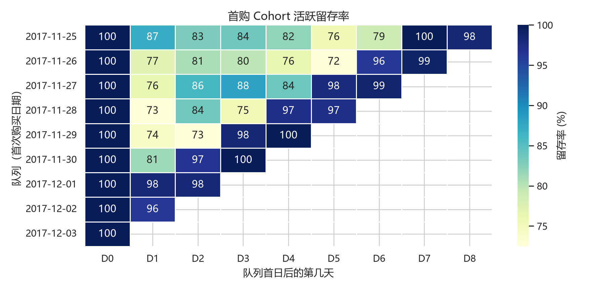
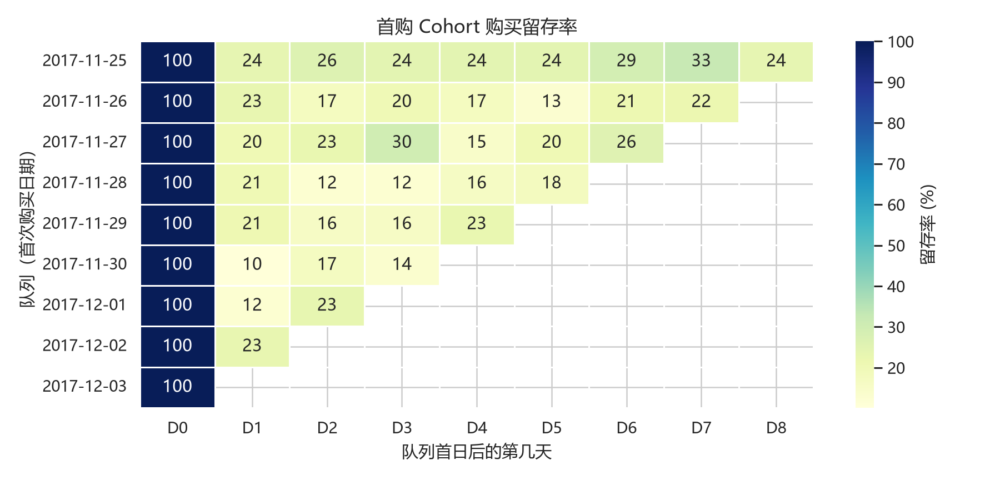

# 首购 Cohort 留存分析

## 1. 这份报告回答什么

把用户按“第一次购买”的日期分成若干队列，观察他们在之后第 1、2……8 天是否还回来。
它回答的是：**新客买完一次之后，还会不会继续活跃 / 继续买？**

> **样本说明**：本报告使用 `data/cleaned_user_behavior.csv`（983 个用户、人均 101.68 条行为）。Cohort 需要同一个用户的多条行为，而对照样本是随机按行抽样（人均 1.09 条），无法做留存。两者的差异见第 10 节。

## 2. 口径

- 队列：按用户首次购买日期分组。
- 活跃留存：第 N 天有任意行为（浏览、收藏、加购、购买都算）。
- 购买留存：第 N 天再次发生购买。
- 第 N 天 = 行为日期 − 队列日期，D0 即队列当天。
- 观察窗口：2017-11-25 至 2017-12-03。
- 尚未到观察期的格子记为“—”，**不能当成 0**；否则尾部会被误读成流失。

## 3. 样本概览

| 指标 | 数值 |
| --- | --- |
| 用户数 | 983 |
| 入队用户数 | 671 |
| 队列数 | 9 |
| 人均行为数 | 101.68 条 |

> 入队用户数小于总用户数，是因为没有购买行为的用户不属于“首购队列”。

## 4. 队列规模

| 队列 | 人数 | 可观察天数 |
| --- | --- | --- |
| 2017-11-25 | 123 | 9 |
| 2017-11-26 | 109 | 8 |
| 2017-11-27 | 93 | 7 |
| 2017-11-28 | 73 | 6 |
| 2017-11-29 | 62 | 5 |
| 2017-11-30 | 59 | 4 |
| 2017-12-01 | 56 | 3 |
| 2017-12-02 | 52 | 2 |
| 2017-12-03 | 44 | 1 |

## 5. 活跃留存矩阵

每一行是一个队列，每一列是队列首日后的第几天，格子里的数字是留存率。

| 队列 | 人数 | D0 | D1 | D2 | D3 | D4 | D5 | D6 | D7 | D8 |
| --- | --- | --- | --- | --- | --- | --- | --- | --- | --- | --- |
| 2017-11-25 | 123 | 100.0% | 87.0% | 82.9% | 83.7% | 82.1% | 75.6% | 78.9% | 100.0% | 98.4% |
| 2017-11-26 | 109 | 100.0% | 77.1% | 80.7% | 79.8% | 76.1% | 72.5% | 96.3% | 99.1% | — |
| 2017-11-27 | 93 | 100.0% | 76.3% | 86.0% | 88.2% | 83.9% | 97.8% | 98.9% | — | — |
| 2017-11-28 | 73 | 100.0% | 72.6% | 83.6% | 75.3% | 97.3% | 97.3% | — | — | — |
| 2017-11-29 | 62 | 100.0% | 74.2% | 72.6% | 98.4% | 100.0% | — | — | — | — |
| 2017-11-30 | 59 | 100.0% | 81.4% | 96.6% | 100.0% | — | — | — | — | — |
| 2017-12-01 | 56 | 100.0% | 98.2% | 98.2% | — | — | — | — | — | — |
| 2017-12-02 | 52 | 100.0% | 96.2% | — | — | — | — | — | — | — |
| 2017-12-03 | 44 | 100.0% | — | — | — | — | — | — | — | — |



## 6. 购买留存矩阵

只统计“又买了一次”的人，比活跃留存严格。

| 队列 | 人数 | D0 | D1 | D2 | D3 | D4 | D5 | D6 | D7 | D8 |
| --- | --- | --- | --- | --- | --- | --- | --- | --- | --- | --- |
| 2017-11-25 | 123 | 100.0% | 23.6% | 26.0% | 24.4% | 24.4% | 24.4% | 29.3% | 32.5% | 23.6% |
| 2017-11-26 | 109 | 100.0% | 22.9% | 17.4% | 20.2% | 17.4% | 12.8% | 21.1% | 22.0% | — |
| 2017-11-27 | 93 | 100.0% | 20.4% | 22.6% | 30.1% | 15.1% | 20.4% | 25.8% | — | — |
| 2017-11-28 | 73 | 100.0% | 20.5% | 12.3% | 12.3% | 16.4% | 17.8% | — | — | — |
| 2017-11-29 | 62 | 100.0% | 21.0% | 16.1% | 16.1% | 22.6% | — | — | — | — |
| 2017-11-30 | 59 | 100.0% | 10.2% | 16.9% | 13.6% | — | — | — | — | — |
| 2017-12-01 | 56 | 100.0% | 12.5% | 23.2% | — | — | — | — | — | — |
| 2017-12-02 | 52 | 100.0% | 23.1% | — | — | — | — | — | — | — |
| 2017-12-03 | 44 | 100.0% | — | — | — | — | — | — | — | — |



## 7. 加权留存汇总

把每个队列按人数加权，并只统计“当天确实可观察”的队列。

| 第几天 | 可观察队列数 | 活跃留存 | 购买留存 |
| --- | --- | --- | --- |
| D0 | 9 | 100.0% | 100.0% |
| D1 | 8 | 82.0% | 20.1% |
| D2 | 7 | 84.9% | 19.8% |
| D3 | 6 | 86.1% | 20.6% |
| D4 | 5 | 85.9% | 19.3% |
| D5 | 4 | 83.9% | 19.1% |
| D6 | 3 | 90.5% | 25.5% |
| D7 | 2 | 99.6% | 27.6% |
| D8 | 1 | 98.4% | 23.6% |

### 7.1 每日活跃用户（用来解释尾部反弹）

| 日期 | DAU |
| --- | --- |
| 2017-11-25 | 695 |
| 2017-11-26 | 723 |
| 2017-11-27 | 708 |
| 2017-11-28 | 720 |
| 2017-11-29 | 724 |
| 2017-11-30 | 712 |
| 2017-12-01 | 718 |
| 2017-12-02 | 962 |
| 2017-12-03 | 965 |

> 本样本 DAU 最高的两天是 2017-12-03、2017-12-02（965、962），明显高于前后几天。所以任何队列在这两天都会显得“留存高”，这是大盘效应，不是用户变忠诚。

## 8. 怎么读这张表

- **D0 一定是 100%**：队列按首次购买定义，D0 的活跃和购买留存都应为 100%；不是就说明代码或数据有问题。
- **D1 活跃留存 82.0%**：8 个队列可观察。
- **D1 购买留存 20.1%**：8 个队列可观察。
- **D7 活跃留存 99.6%**：仅 2 个队列可观察，且落在全站活跃高峰日，**不建议当作留存结论**。
- **D7 购买留存 27.6%**：2 个队列可观察。
- 矩阵是**三角形**：越晚的队列能观察的天数越少，右边的“—”不是流失。
- 购买留存比活跃留存更接近“真实复购意愿”，做留存运营时优先看它。

## 9. 局限（必须写进报告）

- 数据窗口只有 9 天，只能看短期回访，**不能外推月留存 / 长期留存**。
- 队列人数在 44~123 人之间，单格波动大；人数少于 30 的队列不应单独下结论。
- 样本是“已经产生行为的用户”，不含曝光人群和新访客，留存率会偏高。
- 本样本人均 101.68 条行为，用户几乎每天在线，活跃留存（如 D1 82.0%）不能当作真实产品留存率。
- 首购队列只覆盖买过的人，不能代表全部新用户。
- 活跃留存受全站日活波动影响，购买留存更接近用户真实复购意愿。

## 10. 对照：换一种抽样方式会怎样

用同一个脚本跑「随机按行抽样」样本，结果如下：

| 指标 | 首购样本（用户完整） | 随机按行抽样 |
| --- | --- | --- |
| D1 活跃留存 | 82.0% | 1.7% |
| D1 购买留存 | 20.1% | 0.2% |
| D3 活跃留存 | 86.1% | 1.4% |
| D3 购买留存 | 20.6% | 0.0% |
| D7 活跃留存 | 99.6% | 0.5% |
| D7 购买留存 | 27.6% | 0.0% |

- 对照样本人均行为数：1.09 条（首购样本（用户完整） 101.68 条）。
- 对照样本按行随机抽样，同一个用户的行为被拆散，D1 之后几乎凑不出“再次活跃”。
- 这说明 **Cohort 分析必须使用“用户完整”的样本**；否则留存率会接近 0，不是业务结论而是抽样假象。
- 详细对比见 `reports/sampling_comparison.md`。

## 11. 复现

```powershell
python src/cohort_retention.py `
  --input data/cleaned_user_behavior.csv `
  --cohort-type purchase `
  --max-day 8 `
  --compare-input data/cleaned_user_behavior_random_sample.csv `
  --compare-label "随机按行抽样"
```

产物：

- `reports/cohort_retention.md`（本报告）
- `reports/figures/cohort_activity.png` / `reports/figures/cohort_purchase.png`（两张热力图）
- `reports/cohort_activity_matrix.csv` / `reports/cohort_purchase_matrix.csv`（矩阵 CSV，可直接丢进 Excel）
